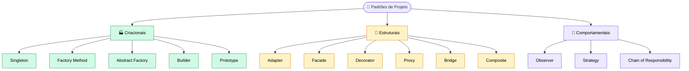

# 🧩 Padrões de Projeto

> **Padrões de projeto** (*design patterns*) são soluções já pensadas e exaustivamente validadas por desenvolvedores de software para problemas que se repetem no design de sistemas.

---

## 🗂️ As 3 categorias

Existem **3 categorias** básicas de padrões de projeto:

| Categoria | Ligada a... | Exemplos |
|:--|:--|:--|
| 🏭 **Criacionais** | Controle e criação de objetos | Singleton, Factory Method, Abstract Factory, Builder, Prototype |
| 🧱 **Estruturais** | Estruturação entre objetos e classes | Adapter, Facade, Decorator, Proxy, Bridge, Composite |
| 💬 **Comportamentais** | Comunicação entre objetos e distribuição de responsabilidades | Observer, Strategy, Chain of Responsibility |

---

## ✅ Quando utilizar

### 🏭 Criacionais: o exemplo do Singleton

- 🗄️ **Conexão com o banco de dados**: restringimos a porta de entrada para o banco a uma única instância (ou a um único *pool* de conexões), evitando conexões soltas pelo sistema.
- 📝 **Gestão de logs**: com um único ponto de registro, todas as mensagens passam pelo mesmo lugar. Não há instâncias perdidas ou desconhecidas, e os logs ficam centralizados e fáceis de acompanhar.

### 🧱 Estruturais: os exemplos de Adapter e Facade

- 🔌 Quando o **mesmo sistema precisa ser acessado por interfaces diferentes**, ou precisa atender dispositivos e clientes distintos sem que o seu núcleo seja alterado.
  - **Adapter**: traduz uma interface para a que o outro lado espera.
  - **Facade**: oferece uma porta de entrada simples para um conjunto de classes complexas.

### 💬 Comportamentais: os exemplos de Observer e Strategy

- 🔔 **Observer**: quando precisamos ser **avisados automaticamente** se algo mudar na aplicação, em situações previamente mapeadas. Exemplo: enviar uma mensagem quando um evento acontece.
- 💳 **Strategy**: quando temos **diferentes meios de pagamento** para a compra de um produto (Pix, cartão, boleto) e queremos escolher entre eles sem encher o código de `if/else`.

> [!NOTE]
> No Observer, ninguém precisa ficar "escaneando" a aplicação o tempo todo. Quem tem interesse se **inscreve** e é **notificado** quando a mudança acontece.

### 📌 Resumo rápido

| Situação | Categoria | Padrão |
|:--|:--:|:--:|
| Uma única porta de entrada para o banco de dados | 🏭 | Singleton |
| Gestão centralizada de logs | 🏭 | Singleton |
| Mesmo sistema acessado por interfaces diferentes | 🧱 | Adapter |
| Avisar quando uma mudança mapeada acontecer | 💬 | Observer |
| Vários meios de pagamento para uma compra | 💬 | Strategy |

---

## ⛔ Quando NÃO utilizar

> [!WARNING]
> O padrão **não é o fim**, e sim o **meio** para alcançar um bom design de software. Se utilizá-lo torna a execução mais difícil ou faz pouca diferença, **não faz sentido usá-lo**.